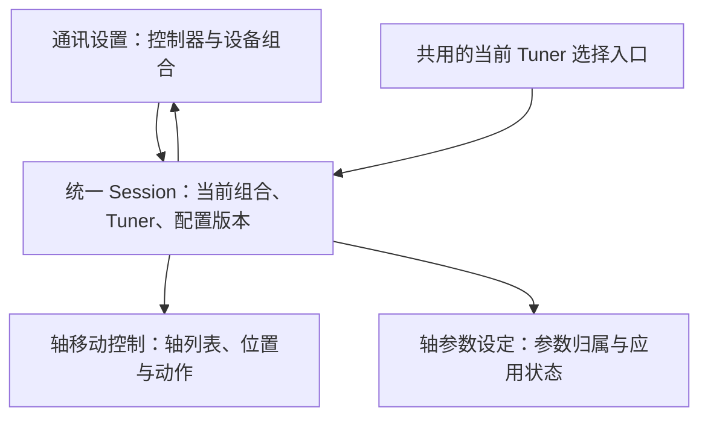

# Tuner 类型、轴号和轴参数联动设计说明

日期：2026-11-11。适用目标：Windows 桌面端及其共用后端。

本文保留三页联动的设计基线；现已按下方 A01–A18 更新源码，实施结果、自动化证据与待完成的 Windows/实机项目见 [实现与验收记录](TUNER_CONFIGURATION_ACCEPTANCE.md)。VNA 的离线手册核对另见该记录末尾链接。

## 1. 需求和设计结论

一个运动控制器支持三种设备组合，三者互斥：

| 设备组合 | Tuner | 逻辑轴与控制器物理轴号 | 未使用物理轴 |
|---|---|---|---|
| 单台三轴 | Tuner 1 | X→0，Z1→1，Z2→2 | 3、4、5 |
| 双台三轴 | 左 Tuner | X→0，Z1→1，Z2→2 | 无 |
| 双台三轴 | 右 Tuner | X→3，Z1→4，Z2→5 | 无 |
| 单台四轴 | Tuner 1 | X→0，Z1→1，Z2→2，Z3→3 | 4、5 |

采用“控制器连接共用、设备组合确定映射、当前 Tuner 确定操作对象、每轴参数独立”的模型。

正常用户只选择上述设备组合和其中的 Tuner，物理轴号自动生成并只读。不提供会产生“左四轴＋右三轴”的自由组合。控制器具有六轴能力，不等于现场一定接有两台 Tuner。

## 2. 统一配置模型

### 2.1 三类信息分别管理

| 信息 | 所属对象 | 内容及规则 |
|---|---|---|
| 控制器连接 | 控制器配置 | 配置 ID、IP、真实/虚拟模式、启动连接选项；同一控制器共用一个连接 |
| 设备组合与操作对象 | 当前控制器配置 | 当前组合、当前 Tuner；组合定义唯一合法的型号、轴集合、轴号映射 |
| 轴参数 | 控制器配置＋设备组合＋Tuner＋逻辑轴 | 当量、速度、方向、限位、回零及反馈参数；分别保存，禁止跨对象自动覆盖 |

配置 ID 应是应用内稳定标识，IP 是可修改的连接地址。IP 改动不自动覆盖另一份控制器配置；换接另一台物理控制器需重新核对身份、接线与参数。

配置归属结构示意（非 JSON 字段原样展示，实际实现使用 schema 6）：

```text
控制器配置 controller_1
├─ connection：IP、真实/虚拟模式、启动选项
├─ active_layout：single_3 / dual_3 / single_4
├─ active_tuner_by_layout：每种组合上次选择的 Tuner
└─ profiles
   ├─ single_3
   │  └─ tuner_1 → X、Z1、Z2 的独立参数
   ├─ dual_3
   │  ├─ left  → X、Z1、Z2 的独立参数
   │  └─ right → X、Z1、Z2 的独立参数
   └─ single_4
      └─ tuner_1 → X、Z1、Z2、Z3 的独立参数
```

参数身份键为 `(controller_id, layout_id, tuner_id, logical_axis)`。物理轴号根据组合定义推导，不能只以 `X` 或 `axis_3` 作为全局参数键。

例如：双三轴的“右 X”和单四轴的“Z3”都使用物理轴 3，但对应不同机械轴用途，不能共用参数；两套配置的轴 0 参数也分别保留，需要复用时显式复制。

### 2.2 一个权威来源，避免重复状态

- 组合定义产生 Tuner 列表、型号、逻辑轴列表和物理映射，禁止分别保存几份可互相矛盾的 `axis_count`。
- 参数只由该组合下的参数对象管理；兼容旧接口所需的 `settings.axes` 等只能作为派生视图，不能成为另一份可独立修改的数据。
- 连接状态、实际位置、运动状态、已回零状态和控制器读回值属于运行状态，不能因为本地配置中有同名字段就认为硬件已经满足。
- “参数草稿”“已保存配置”“控制器读回值”分别管理，比较结果用于显示是否一致。

## 3. 三个页面如何联动

全局共享同一个 Session/状态对象。三个页面显示一致的上下文：

> 双台三轴｜当前：右 Tuner｜X＝轴3、Z1＝轴4、Z2＝轴5



### 3.1 通讯设置

1. 选择真实/虚拟控制器，设置控制器 IP。
2. 选择设备组合：单台三轴、双台三轴或单台四轴。
3. 显示完整映射表，双台时可选择当前左/右 Tuner。
4. 连接后显示实际连接状态，并允许读回当前 Tuner 对应物理轴的参数作比较。

单台组合只显示 Tuner 1，不出现无效的左/右切换。轴号为只读；原点输入、回零输出等接线配置单独设置。

### 3.2 轴移动控制

- 只生成当前 Tuner 实际拥有的轴：三轴三行，四轴四行。
- 每行持续显示“逻辑轴＋物理轴号”，例如“右 Tuner / Z1 / 轴4”。
- 位置、运动状态、原点信号、回零状态及动作都使用同一轴映射。
- 左/右切换后，旧位置不能暂时留在新轴标题下；先清空旧显示，读取新对象后再显示。
- 未使用轴不生成普通运动入口；动作不能借助隐藏控件或旧选择访问它们。
- 停止入口不依赖当前页面选择；应能停止本控制器当前任务涉及的全部目标轴。具体停止能力沿用控制器驱动协议，不将界面按钮等同于硬件急停回路。

### 3.3 轴参数设定

页面显式显示参数归属和物理映射，不能只显示一个没有归属的“X”。

| 操作 | 行为 |
|---|---|
| 保存配置 | 只保存电脑配置，不发送控制器写指令 |
| 读取控制器参数 | 读取当前 Tuner 对应物理轴，展示与已保存值的差异；不自动覆盖已保存配置 |
| 写入当前轴 | 只写入明确选中的一根轴，随后读回校验 |
| 写入当前 Tuner | 仅写当前 Tuner 的全部轴，显示逐轴结果 |
| 采用读回值 | 用户明确选择后，才把选中读回字段更新为配置值 |
| 从其他配置复制 | 明确指定源和目标，预览字段差异；物理映射不可随参数复制，接线字段默认不复制 |

不提供普通操作下的“写入控制器所有六轴”按钮。写入部分失败不显示整体成功，也不假设物理控制器能够原子回滚；保留成功、失败、未执行的逐轴结果，重新读取确认实际状态后才恢复相应运动能力。

状态建议分两类显示：

- 编辑状态：无修改 / 存在未保存修改。
- 应用状态：未读取 / 与配置一致 / 存在差异 / 写入或校验失败。

## 4. 每轴参数和接线

| 分类 | 独立保存的字段 |
|---|---|
| 运动参数 | 轴类型、脉冲当量、运动方向、速度、点动速度、加速度、减速度 |
| 行程与反馈 | 正负软限位、反馈标度及相关单位约定 |
| 回零 | 回零模式、速度、爬行速度、等待时间、原点输入及其有效逻辑 |
| 驱动接线 | 当前回零实现实际需要的输出通道、脉冲时序及有效逻辑 |

逻辑轴、控制器物理轴号、数字输入号、数字输出号是不同概念。不可因“右 X 使用轴3”而自动推断其原点输入或输出通道也是 3。

现有代码中的输入/输出基址只能作为已有机台的接线默认值来源；最终参数须按实际接线独立确认。若硬件确有共用输入或输出，由明确的接线规则表达，不能用任意连续编号代替，也不能把所有共享信号一律当作错误。

新参数允许使用默认值辅助编辑，但必须标记为未核对，不能将另一台 Tuner 的已调参数自动当成本台实测值。

## 5. 切换与任务规则

| 操作 | 允许条件 | 生效内容 |
|---|---|---|
| 切换当前 Tuner | 该控制器无运动、回零、建库、参数写入等运行任务；参数草稿已处理 | 保持控制器连接，原子切换参数视图、轴映射和页面上下文；不自动运动、回零或写参数 |
| 更换设备组合 | 控制器已断开且没有运行任务 | 整套替换 Tuner 列表及映射，恢复该组合独立保存的参数，旧组合参数保留 |
| 修改轴参数草稿 | 对象归属明确 | 只影响该轴的编辑草稿 |
| 写入轴参数 | 已连接、目标轴明确且相关任务空闲，参数验证通过 | 写入目标物理轴并读回，更新应用状态 |

有未保存修改时，切换可选择“保存后切换 / 放弃修改 / 取消”；保存后切换只代表保存电脑配置，不顺带写硬件。

运行任务创建时，固定 `controller_id、layout_id、tuner_id、轴映射、配置版本`。工作线程不得在执行中再次从界面读取 active_tuner，也不得因后续页面刷新而改换目标。

提交配置时先检查完整候选组合，再一次性提交并刷新；验证失败时维持原配置。后台/API 请求应带预期配置版本，版本过期则拒绝执行，避免另一个界面刚切换对象就收到旧任务的写入。

### 回零和校准结果

- 回零状态按每根实际绑定轴维护，不把左侧已回零当成右侧已回零。
- 仅切换页面或当前 Tuner，不应无条件要求全部轴重新回零；原连接、映射、参数和可信回零状态都有效时可保留。不能可靠确认的状态显示“未确认”，不能伪造已回零。
- 断线重连、控制器复位、回零失败或坐标绑定变化后，重新核实状态，不能直接从磁盘恢复“已回零”标记。
- 改变方向、脉冲当量、反馈标度或回零基准时，使受影响轴的原坐标可信状态失效，并使依赖该坐标的校准数据失效；更改速度不自动清除全部回零状态。
- 参数写入或核对未完成时，禁用会依赖错误单位/方向的运动操作，仍保留停止能力。

## 6. 后端约束

以下规则在设置加载、候选配置提交、连接以及实际指令入口均应成立，不能只由 UI 下拉框保证：

1. 只接受三个受支持的设备组合。
2. 当前 Tuner 必须属于当前组合；逻辑轴必须属于该 Tuner。
3. 同一组合的物理轴号不得重复，不得越过该控制器已确认的能力范围。
4. 指令目标只能由该组合的统一映射器计算，禁止使用 `X/Z1/Z2` 的列表下标直接当物理轴号。
5. 未配置轴、旧页面缓存目标和过期配置版本不能发送动作或参数写入。
6. 轴参数类型、有限数值、正负限位关系、单位及设备支持范围都要先验证。
7. 一次参数保存仅影响指定对象，不能替换另一台 Tuner 的参数集合。
8. 模拟控制器使用相同的映射和参数归属，但模拟的位置、回零、故障及应用确认不能作为真实控制器的有效状态。

## 7. 实现位置

| 文件 | 原有基础 | 本次调整 |
|---|---|---|
| `TunerLab/tuner/tuner_units.py` | Tuner 对象、逻辑轴到物理轴映射、重叠校验 | 定义三个固定组合；对当前组合执行强校验 |
| `TunerLab/tuner/settings.py` | 每台 Tuner 参数、当前对象及序列化 | 增加组合标识及独立配置集合，消除 `axis_count/axes/units` 多份可变状态的不一致 |
| `TunerLab/tuner/ui_hardware.py` | Session、参数保存、当前 Tuner 切换 | 统一切换事务、任务守卫、参数应用状态和状态通知 |
| `TunerLabApp/tunerlab_app/session.py` | 桌面运动适配器和连接包装 | 切换后保留正确映射、单位处理和超时；不在切换中隐式写参数或改变任务目标 |
| `TunerLabApp/tunerlab_app/pages_comm.py` | 型号与当前 Tuner 选择 | 用设备组合替代可自由组合的数量/轴数选择，统一上下文 |
| `TunerLabApp/tunerlab_app/pages_motion.py` | 轴状态及运动入口 | 按当前组合和 Tuner 重建显示，所有动作绑定目标快照 |
| `TunerLabApp/tunerlab_app/pages_params.py` | 轴参数编辑 | 显示归属，分开保存、写入、读取和采用读回值 |
| `TunerLab/tuner/web/handlers.py` | 型号、当前 Tuner 及参数接口 | 与桌面走同一个 Session 服务；拒绝非法组合、忙碌切换和过期写请求 |

原先 `TunerSettings.set_unit_axis_count()` 允许四轴与另一台 Tuner 的轴块重叠；现已改为固定组合校验，不再仅提示后继续。新增 `TunerLab/tuner/layout_session.py` 负责切换事务、排队任务租约、版本校验和逐轴参数状态；`installation_bar.py` 为页面共用选择栏。

原先切换当前 Tuner 时可能因重建对象而丢失状态；现按连接内对象缓存管理左右轴的可信回零状态，断线、坐标变更及真实/虚拟切换后按规则失效。

## 8. 旧配置迁移

配置 schema 已由 5 升至 6；修复随应用版本 0.5.14 发版。备份文件名、恢复方式及实际验证见 [验收记录](TUNER_CONFIGURATION_ACCEPTANCE.md#配置迁移与恢复)。以下为迁移规则。

1. 迁移前保留原始配置备份；保留原有连接参数、轴参数、VNA 方言及其他无关字段。
2. 按旧 schema 已定义的语义识别型号，不能仅凭保存了 Z3 参数就认定现场一定是四轴；旧配置允许保留非当前型号的参数。
3. 旧配置明确对应单三轴或单四轴时，参数迁入相应组合，原始数值保持不变。
4. 旧版默认会生成左右两台 Tuner，因此只有“两条 unit 记录”并不能证明现场接了双台。缺乏明确安装组合信息时，保留迁移候选和原参数，首次进入真实控制时让用户确认组合，不擅自当作已核对安装。
5. 存在轴号重叠、轴数与映射矛盾或归属不明的配置，允许查看/导出，但不下发运动或参数写入；明确显示需要修正的具体字段。
6. 新组合没有参数时生成未核对草稿，允许显式复制适用字段，不能把另一组合标记为已应用。
7. 原子保存新配置；失败保留原文件及可恢复状态。不在加载、迁移或切换过程中自动写入物理控制器。

## 9. 验收清单

下表为验收要求，现已完成模拟指令链路、Session、HTTP 和 Qt 页面验证；逐项用例见 [验收记录](TUNER_CONFIGURATION_ACCEPTANCE.md#a01a18-自动化核对)。Windows 和实机的读回、接线与实际动作仍待现场验证。

| 编号 | 场景 | 必须满足的结果 |
|---|---|---|
| A01 | 单台三轴 | 三页仅显示 X/Z1/Z2，所有动作和写参数只针对 0/1/2 |
| A02 | 双台三轴选左侧 | 操作及参数归属为左侧，仅使用 0/1/2 |
| A03 | 双台三轴选右侧 | 操作及参数归属为右侧，仅使用 3/4/5 |
| A04 | 单台四轴 | 显示 X/Z1/Z2/Z3，Z3 指向轴3；无右 Tuner 入口；不访问轴4/5 |
| A05 | 修改左 X 参数 | 右 X 的配置、读回记录及应用状态均不被覆盖 |
| A06 | 切换设备组合再切回 | 原组合各轴参数保持，轴3不会因另一组合的用途被静默替换 |
| A07 | 三页之间切换 Tuner | 标题、轴行、位置、参数和动作目标同步，无旧位置冒充新轴的瞬间显示 |
| A08 | 未保存参数时切换 | 保存/放弃/取消各自正确，保存不隐式写控制器 |
| A09 | 运动、回零或建库期间切换 | UI 与后台都拒绝；原任务目标固定，停止仍可用 |
| A10 | 外部/API 提交重叠组合 | 拒绝提交且原配置不变，控制器无额外动作 |
| A11 | 保存与写入分开 | 本地保存不产生硬件写；写当前轴/Tuner 不触及其他轴 |
| A12 | 参数部分写入失败 | 逐轴显示成功/失败/未执行，不显示整体已应用；核实实际状态后才恢复操作 |
| A13 | 方向、当量等坐标参数变更 | 仅相关轴及依赖它的校准状态按规则失效 |
| A14 | 单纯切换左右 Tuner | 不重连、不自动回零、不写参数；有效回零状态不串台 |
| A15 | 断开重连或复位 | 不沿用未经核实的已回零、参数一致和校准有效状态 |
| A16 | 旧配置迁移及失败恢复 | 参数数值、未知安装候选与无关 VNA 设置保留，备份可恢复 |
| A17 | 过期请求或旧页面按钮 | 拒绝旧配置版本，绝不将原目标动作转到当前新 Tuner |
| A18 | 虚拟/真实模式切换 | 映射规则一致，模拟状态不被当成实机核验结果 |

## 10. 实施顺序与后续范围

1. 先完成组合定义、唯一映射、参数归属及配置迁移的后端实现和测试。
2. 增加统一切换事务、运行任务守卫及参数应用状态。
3. 接入通讯、运动、参数三页，移除各页独立推导型号/轴号的逻辑。
4. 检查回零、自动建库、搜索调谐等复用运动对象的流程，确保同样携带明确目标和配置版本。
5. 完成三种组合的模拟指令验收，再进行 Windows 与实机接线/参数读回验收。

本方案先按“一个控制器、三个固定组合、一次操作一台当前 Tuner”实现。双台同时自动运行属于后续独立需求，不从当前双台连接能力推导出已支持并行运动调度。
